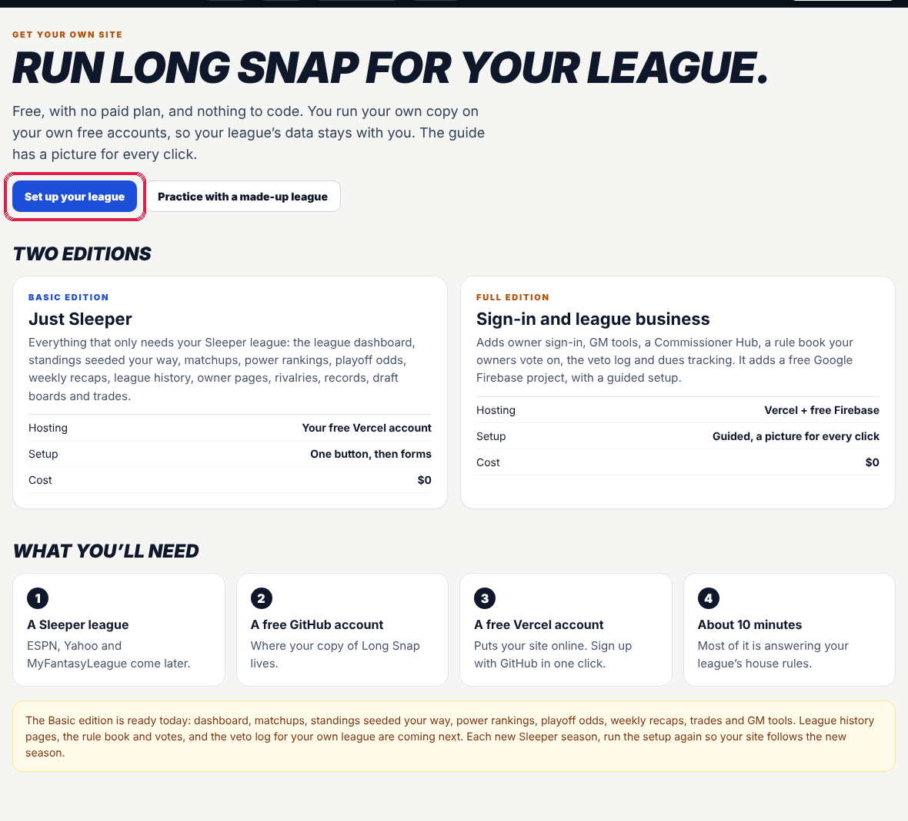
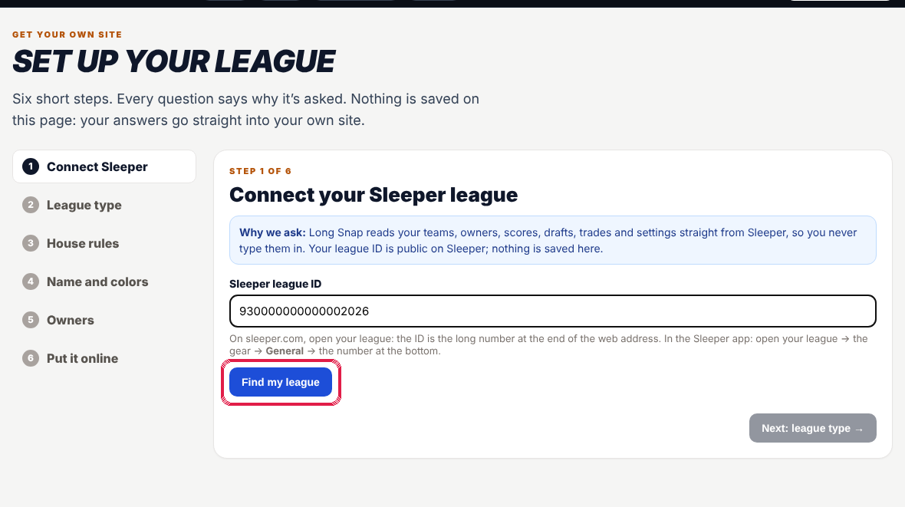
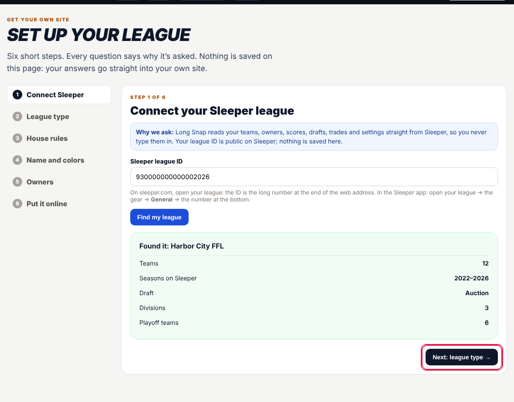
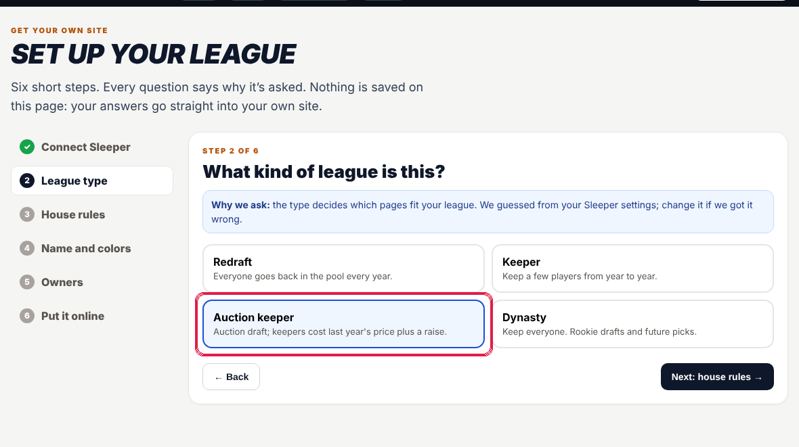
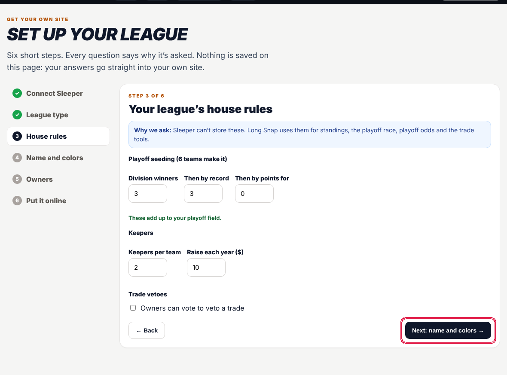
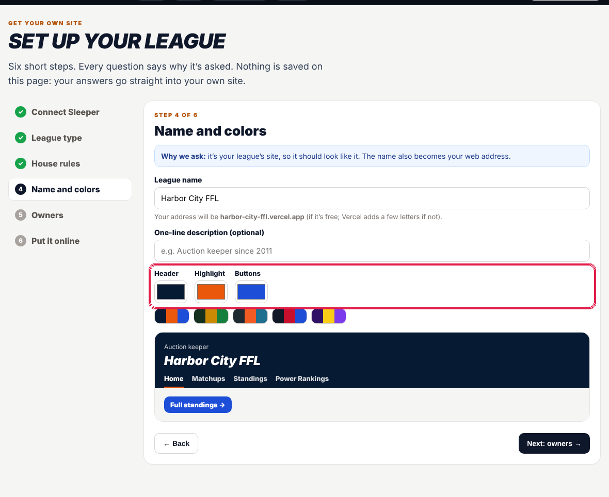
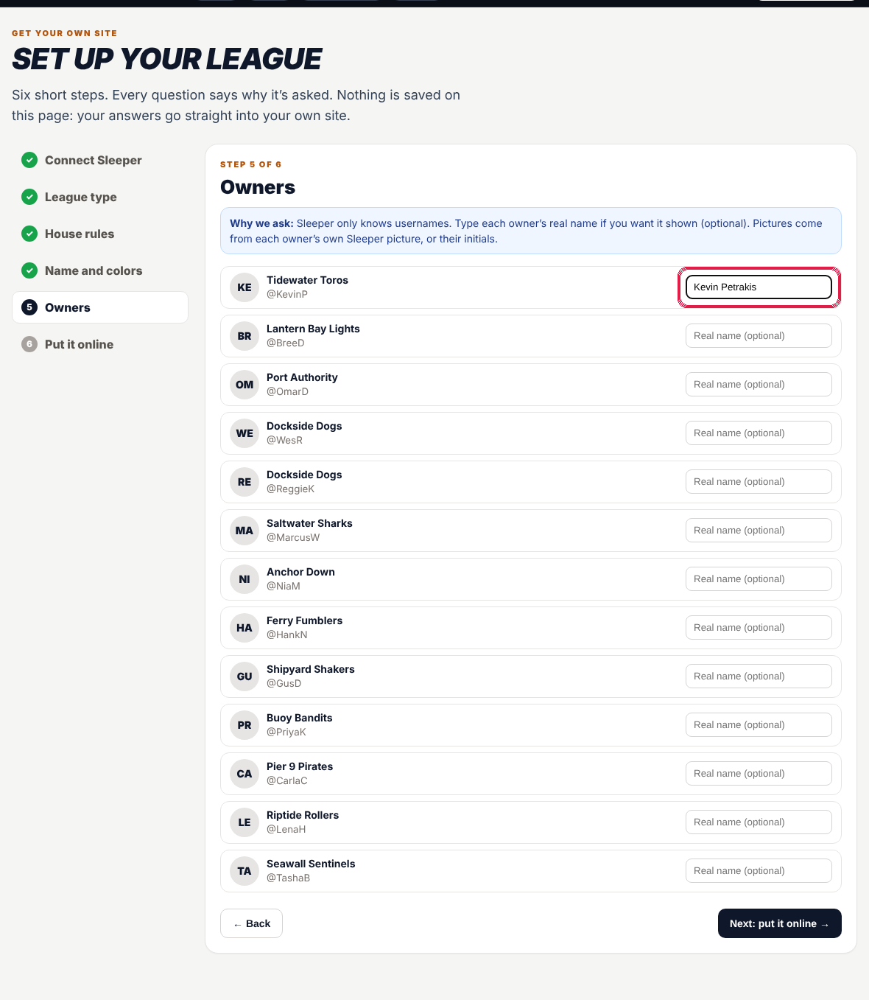
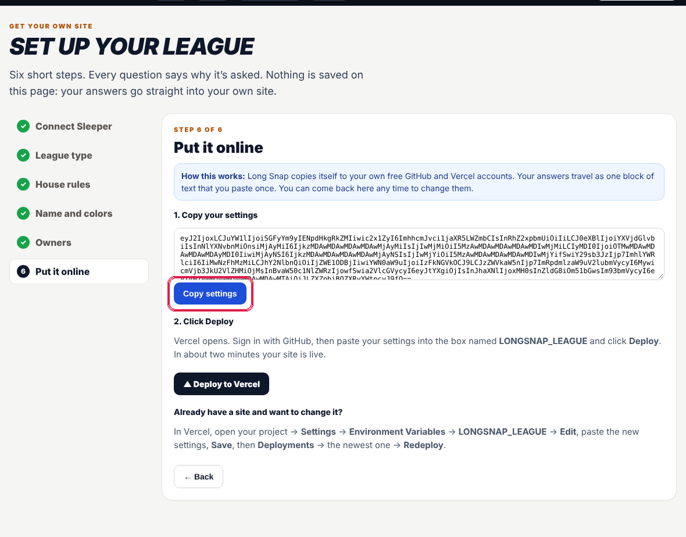
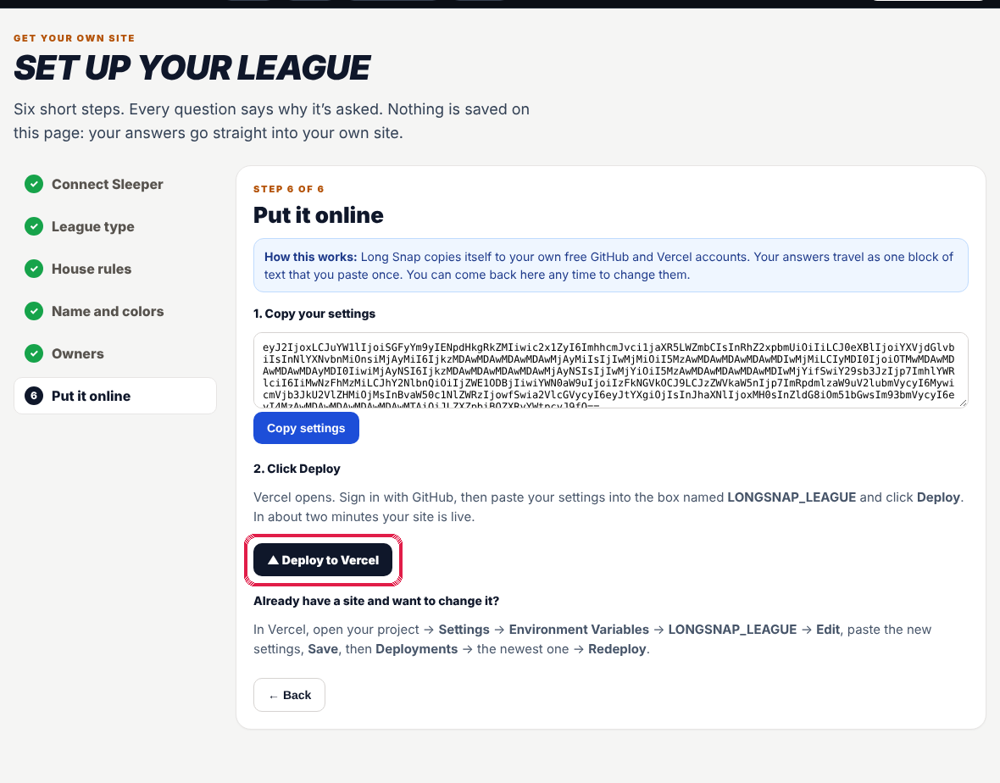
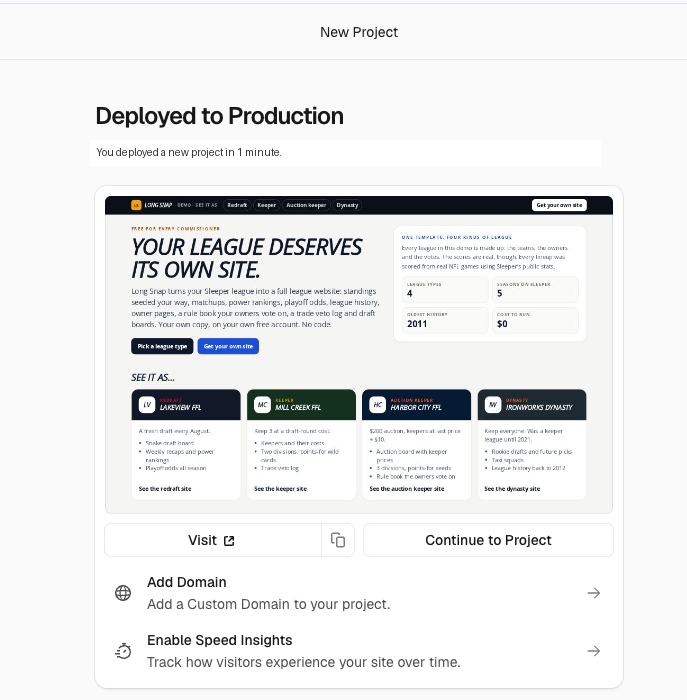

# Put your league on Long Snap

About 10 minutes. Free. No code. You need a Sleeper league, and you'll make free GitHub and Vercel accounts along the way.

Every picture below has a **red box** around the thing to click.

---

## 1. Open the setup

Go to **long-snap.vercel.app/get-started** and click **Set up your league**.

## 2. Paste your Sleeper league ID

Find your league ID:
- **On sleeper.com:** open your league. The ID is the long number at the end of the web address.
- **In the Sleeper app:** open your league → the gear → **General** → the number at the bottom.

Paste it in the box and click **Find my league**.

Long Snap shows what it found: your league name, teams, seasons, draft type and divisions. Click **Next: league type**.

## 3. Pick your league type

Long Snap guesses from your Sleeper settings. Change it if the guess is wrong, then click **Next: house rules**.

## 4. Answer your house rules

How your playoff seeds are decided (division winners, then record, then points for), keepers, and trade vetoes. The numbers must add up to your playoff field. Click **Next: name and colors**.

## 5. Name and colors

Your league's name becomes your web address. Click a color set or pick your own; the preview shows how it looks. Click **Next: owners**.

## 6. Owners (optional)

Sleeper only knows usernames. Type real names if you want them on the site. Pictures come from each owner's Sleeper picture. Click **Next: put it online**.

## 7. Copy your settings

Click **Copy settings**. Everything you answered is in that one block of text.

## 8. Click Deploy to Vercel

Vercel opens in a new tab.

1. If you don't have a Vercel account: click **Continue with GitHub**. If you don't have a GitHub account either, GitHub walks you through making one (free).
2. Vercel asks where to put your copy of Long Snap. Leave the name as it is and click **Create**.
3. You'll see a box named **LONGSNAP_LEAGUE**. Click in it and paste (Cmd+V on a Mac, Ctrl+V on Windows).
4. Click **Deploy**.

## 9. Your site is live

In about two minutes Vercel says **Deployed to Production**. Click **Visit** to open your site. Its address is under **Domains** on your project page, like `your-league.vercel.app`. Share it with your league.

---

## Changing something later

Run the setup again at **long-snap.vercel.app/get-started/setup** and copy the new settings. Then in Vercel: open your project → **Settings** → **Environment Variables** → **LONGSNAP_LEAGUE** → **Edit** → paste → **Save**. Then **Deployments** → the newest one → the **⋯** menu → **Redeploy**.

## A new season

Sleeper starts a new league ID each season. When your league renews, run the setup again with the new ID and update your settings the same way.
